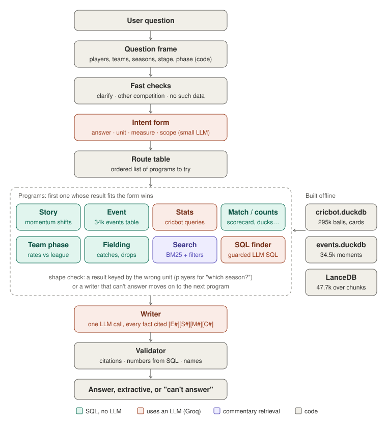

# cricket-rag

**Pandit**, an IPL question-answering agent over 19 seasons of ball-by-ball data (2008–2026).
Every number in an answer comes from SQL; the LLM only decides what kind of question it is and writes the
prose, and a validator checks the prose against the evidence before it is shown.

Built on the [cricbot](https://github.com/piyushdash94/cricbot) archive. Free and CPU-only: DuckDB, LanceDB,
fastembed (ONNX), and Groq's free tier for the LLM.



## How it works

1. **Question frame (code, no LLM).** Players, teams, seasons, stage, phase, innings and over are linked by
   code: full names, nicknames, surnames, typos ("kholi"), era-aware team names.
2. **Fast checks.** Ambiguous names get a clarifying question; other competitions and data the archive
   doesn't hold (captaincy, auctions, ball speed) get a plain "can't answer" with no queries run.
3. **Intent form (one small LLM call).** The model fills a fixed-choice form: *answer* (count, rank, value,
   moment, story, compare…), *unit* (player, team, season, match, innings, partnership…), *measure*, *scope*.
   It never extracts entities.
4. **Route table → programs.** The form picks an ordered list of programs:
   *story* (match facts + momentum shifts), *event* (34k notable moments: wickets, partnerships, drops,
   hat-tricks…), *stats* (cricbot's verified queries), *match*, *counts*, *team phase*, *fielding*,
   *search* (BM25 over one-over commentary chunks), and a guarded *SQL finder* (one read-only SELECT
   written by the LLM over documented views).
5. **Shape check.** A result keyed by the wrong unit ("which season…" answered with a list of players) or a
   writer that can't answer from it moves on to the next program.
6. **Writer + validator.** One LLM call writes ≤5 cited sentences; the validator rejects uncited facts,
   numbers not in the evidence and names not in the sources. Citation slips are fixed in code; anything else
   gets one retry, then the evidence itself is shown. If the writer says the evidence misses the point, the
   SQL finder gets one try before Pandit gives up.

Planner slips seen in use are corrected in code before cricbot's queries run, each under a name in the trace:
"highest economy" means the *worst* economy, "in each phase" is split by phase, "top 5" is not a chase
target, and a one-over sample needs a stated minimum. Averages missing from a table are computed in code.

Momentum shifts (collapses, scoring bursts, squeezes, chase swings, dropped catches) come from cricbot's
detector; the decisive shift is always the strongest one in the **winner's** favour.

## Results

"Clean" = run once on frozen code with new questions. "Practice" = re-scored after fixes informed by those
same questions. Full detail in [evals/RESULTS.md](evals/RESULTS.md).

| Test | Questions | Score | Kind |
|---|---|---|---|
| Fresh 40 from 8 sources, intent router | 40 | **38** (34 exact) | clean |
| Fresh set B, 4 sources (rules router) | 20 | 16 | clean |
| Fresh set A, 4 sources (rules router) | 20 | 16 | clean |
| Forum/FAQ set, 4 sources (first attempt) | 20 | 11 | clean |
| v3 benchmark | 50 | 29 first run; 36–38 now | clean, then practice |
| Events suite (SQL gold by construction) | 20 | 20 | – |
| Decisive momentum shift favours the winner | 1,218 matches | 99.7% (was 75.3%) | full audit |
| Commentary retrieval, BM25 + frame filters | 96 test queries | hit@5 0.92 | held-out split |

## Quick start (Windows, PowerShell)

Needs a [cricbot](https://github.com/piyushdash94/cricbot) checkout with its `data/cricbot.duckdb` built,
and a free Groq API key.

```powershell
copy .env.example .env      # set CRICBOT_ROOT and GROQ_API_KEY
uv sync
uv run pytest               # offline: fixture archive, fake embedder and LLM
uv run cricrag build-index  # ~48k over chunks into LanceDB (embeddings cached)
uv run cricrag build-events # ~34.5k events + momentum shifts; set FIELDING_EVENTS for audited drops
uv run cricrag ask "Where did the 2025 final turn?" --trace
```

### Without uv

`requirements.txt` is exported from `uv.lock` (same pinned versions) and installs the `cricrag` command too.
Python 3.11 or newer:

```powershell
python -m venv .venv
.venv\Scripts\Activate.ps1        # macOS/Linux: source .venv/bin/activate
pip install -r requirements.txt
pip install pytest                 # for the tests
cricrag ask "Where did the 2025 final turn?" --trace   # same commands, no "uv run" prefix
```

After changing dependencies in `pyproject.toml`, refresh it with
`uv export --no-hashes --no-dev -o requirements.txt`. The UI's dependencies are in `frontend/ui/package.json`.

### Match centre UI

Run it the way cricbot does: one backend terminal and one frontend terminal.

```powershell
uv run cricrag serve                         # backend on :8000: Pandit + cricbot's archive, match pages, stats
cd frontend/ui; npm install; npm run dev     # frontend on :3000 (proxies /api to :8000)
```

The backend loads cricbot's archive and stats modules in-process from `CRICBOT_ROOT`, so the cricbot API
does not need to be running. The UI is cricbot's match centre (archive rail, Pandit chat, match workspace,
Stats, Docs, live trace) in a blue-and-white scorecard theme. Pandit's pipeline steps stream into the trace pane
as they run; stats answers show the tables behind them; a match story opens that match beside the chat.
The front page opens on a season: its champions and final, a chart of the average first-innings total for every
season (click a season to load it; the Impact Player rule's arrival in 2023 is marked), the season's numbers,
orange and purple caps, its closest finishes, and a reading room of ESPNcricinfo pieces on rule changes, trends
and records plus any IPL stories in ESPN's live feed (`/api/home`, `/api/news`, `cricrag news`). The season
picker and search sit above the results strip; the left rail holds all-time lists; Pandit sits on the right.
In each match, Overview shows partnerships and dropped catches (fielder, bowler, the batter's score then and the
runs added afterwards), and Momentum lists the shifts and compares powerplay, middle and death overs. Five
colour themes: Floodlit, Night match, Pitch, Pavilion and Pink ball. Commentary comes from the local archive
when ESPN's live feed is unavailable.

Other commands: `cricrag frame "<question>"` (what the code extracted), `cricrag search`, `cricrag news`,
`cricrag eval-pandit --suite v3|events`, `cricrag eval-routes --mode plan|full`, `cricrag eval-retrieval`.
The scripts in `scripts/eval/` re-run the public-question tests above; `scripts/groq_quota.py` shows how much
of Groq's daily quota is left.

## Layout

```
src/cricrag/
  frame.py, entities.py     question frame and entity linker
  agent/intent.py           intent form, route table, shape check
  agent/pandit.py           router and programs, writer, fallbacks
  agent/validate.py         citation, number and name checks
  agent/llm.py              Groq client: model fallback, disk cache, rate-limit waits
  cricbot.py                cricbot's verified stats path, run in-process
  events.py, momentum.py    events table; momentum detector (ported from cricbot)
  story.py                  match facts sheet and shifts
  finder.py                 guarded LLM-written SQL over documented views
  server.py                 the UI's API (`cricrag serve`): chat stream, pipeline graph, archive routes
  matchpage.py              match page extras (local commentary, drops, shifts) and the hall of fame
  news.py                   IPL reading list: ESPN's live feed (IPL stories only) + hand-checked links
  index/, retrieval/        over-level chunks, LanceDB, BM25 / dense / hybrid
  eval/                     v3, events, routing and retrieval evaluations
evals/                      routing labels and results
scripts/eval/               public-question test runs
docs/                       pipeline image, original plan
frontend/ui/                match centre UI (React, vinext), ported from cricbot
Rules.md                    project rules (numbers from SQL only, never tune on held-out data, …)
```

## Limits

- Groq's free tier allows 200k tokens per model per day; one full question costs 2–6k tokens, so long
  evaluations run in batches.
- The routing labels in `evals/` were drafted by an AI and are marked `verified: false` until a person checks them.
- Commentary search rarely decides an answer; most answers come from SQL. Dense embeddings did not beat BM25
  with filters on this data.

## Data and licence

Code: MIT. No data is included. Commentary comes from ESPNcricinfo through the unaffiliated `cricdata`
package: keep it local and show only short, cited snippets. Cricsheet data requires attribution (ODC-By).
